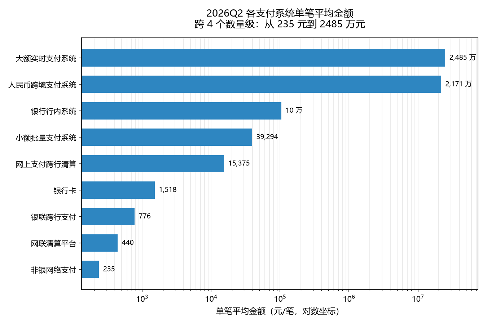
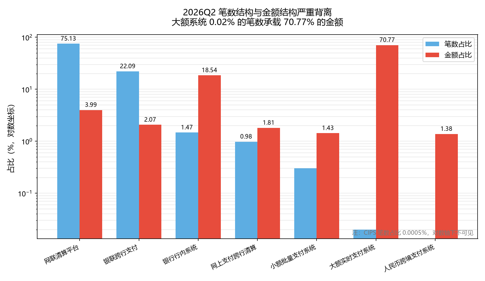
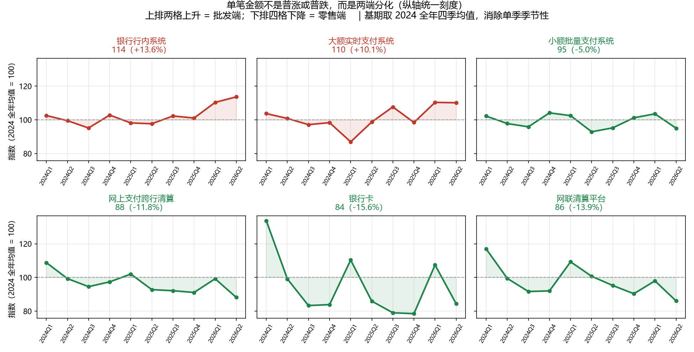
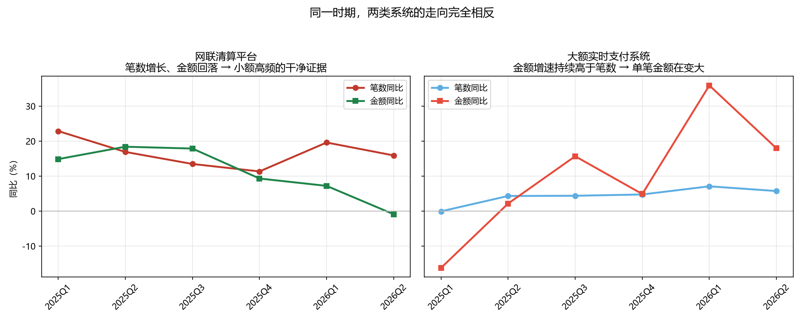
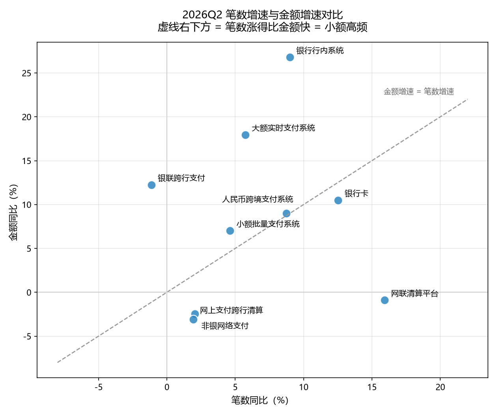

# 中国支付体系运行结构与「小额高频」趋势分析

**结论先行：支付业务并非整体走向小额高频，而是两端分化——零售端单笔金额两年下降 12%–16%，批发端反而上升 10%–14%。「小额高频」只在零售清算通道上成立，把全行业概括成小额高频是错的。**

分析对象：中国人民银行《支付体系运行总体情况》2024Q1–2026Q2 共 10 个季度、13 类业务的笔数与金额数据。

---

## 1. 业务问题

2026 年 8 月，第十五届中国支付清算论坛披露 2025 年人民银行支付系统处理业务金额同比增长 1.6%，低于笔数增速 3.2%。**金额增速慢于笔数增速，通常意味着单笔平均金额在下降。**

这个推论常被直接讲成「支付正在小额高频化」。但它成立吗？如果成立，是所有业务都在变小，还是只有一部分？各清算系统承担的分工不同，笼统的行业平均值可能掩盖方向相反的两种变化。

本分析要回答三个问题：

1. 单笔平均金额是否真的在下降？降在哪些业务上？
2. 笔数与金额的结构分布如何？谁承担笔数、谁承担金额？
3. 如果只有部分业务小额化，那另一部分在发生什么？

## 2. 数据来源

| 项目 | 说明 |
|---|---|
| 原始数据 | 中国人民银行《支付体系运行总体情况》季度报告，2024Q1–2026Q2，共 10 期 |
| 获取方式 | 央行官网「支付结算司 → 支付体系」栏目，逐期下载 PDF |
| 覆盖范围 | 13 类业务的笔数与金额（非现金支付、银行卡、电子支付、大额实时、小额批量、网上支付跨行清算、银联跨行、网联清算、CIPS、非银网络支付、银行行内系统等） |
| 记录数 | 130 条（13 类 × 10 期），无缺失 |
| 补充参考 | 第十五届中国支付清算论坛公开报道（业务动机来源，未用于计算） |

原始 PDF 与清洗后文本保存于 `data/raw/`，结构化数据为 `data/raw/payment_system.csv`。

## 3. 指标口径

**核心指标：单笔平均金额 = 金额 ÷ 笔数**

```
单笔平均金额（元/笔） = 金额（万亿元） ÷ 笔数（亿笔） × 10000
```

乘 10000 是因为「万亿元 ÷ 亿笔」得到的是万元/笔，不是元/笔。这一步容易错，写在这里备查。

**三条口径规则：**

1. **只用单季数据。** 央行季报中部分指标为「上半年」「前三季度」累计数，与单季数不可混用。每期均按单季口径提取。
2. **单位动态识别。** 笔数有「亿笔」「万笔」两种、金额有「万亿元」「亿元」两种，提取时从原文单位换算，统一到亿笔 / 万亿元。
3. **基期用年度均值。** 计算单笔均值变化时，基期取 2024 全年四个季度的均值而非单个季度——2024Q1 受春节因素影响，银行卡单笔均值比全年均值高约 35%，用单季做基期会放大降幅。

## 4. 方法

### 4.1 数据提取

用 `pdfplumber` 提取 PDF 文本，按字号过滤页脚注释（脚注字号小于正文，取正文字号众数后剔除小字号字符），再用锚定关键词的正则提取字段。

提取脚本：`06_clean_txt.py`（文本清洗）、`07_build_csv.py`（结构化）

### 4.2 提取过程中遇到的三类数据问题

**问题一：脚注编号污染数字。** PDF 提取时脚注正文按版面顺序插入正文流，编号直接粘在数字前面。网联清算平台 2026Q2 笔数被读成 `113282.71` 亿笔，实际为 `3282.71` 亿笔——多出来的 `11` 是脚注编号。

**发现方式：** 用报告自身披露的「日均处理业务量」做交叉校验。`3282.71 ÷ 36.07（日均）= 91.0`，正好等于当季工作日数；`113282.71 ÷ 36.07 = 3141` 天，明显不成立。

**问题二：脚注切断句子。** CIPS 段落中「230.64 万笔」后直接插入脚注编号，金额落在另一个句子里，同一条正则取不到两个数。

**问题三：句中插入同比数据。** 部分期次写作「银行卡交易 1180.51 亿笔，同比增长 5.55%，金额 283.89 万亿元」，笔数与金额之间夹了同比增速。

### 4.3 两道自动校验

为防上述问题漏检，对每个提取值跑两道校验：

| 校验 | 规则 | 作用 |
|---|---|---|
| 日均交叉校验 | 笔数 ÷ 日均笔数 ∈ [78, 105]（对应季度工作日约 85–95 天） | 抓出被污染的数字 |
| 跨期中位数校验 | 与同类业务历史中位数偏离超过 10 倍则报警 | 抓出小数点错位、单位错配 |

最终 130 条记录全部通过，人工抽查关键字段与 PDF 原文逐一核对一致。

### 4.4 分析

`pandas` 清洗，`DuckDB` 建表后用 SQL 完成多维聚合：单笔均值、同比增速、笔数与金额的结构占比。SQL 见 `09_metrics.py`。

> 踩坑记录：同比计算用 `LAG(..., 4)`（去年同期），分区键必须是 `category, subcategory` 双字段。只按 `category` 分区会把电子支付的 total / online / mobile 三个子类混在一起比较，得出「同比 +358%」这种荒谬但格式正确的数字。

## 5. 主要发现

### 发现一：单笔金额跨 4 个数量级，支付体系是严格分层的



2026Q2 各清算系统的单笔平均金额，从大额实时支付系统的 2485 万元到非银网络支付的 235 元，相差约 10 万倍。

这不是偶然的数字分布，而是清算系统职能分工的直接体现：大额实时支付系统服务对公批发与金融市场交易，小额批量、网联、银联服务零售消费。

### 发现二：笔数结构与金额结构严重背离



2026Q2：

| 系统 | 笔数占比 | 金额占比 |
|---|---|---|
| 大额实时支付系统 | **0.02%** | **70.77%** |
| 银行行内系统 | 1.47% | 18.54% |
| 网联清算平台 | **75.13%** | **3.99%** |
| 银联跨行支付 | 22.09% | 2.07% |

**0.02% 的笔数承载 70.77% 的金额；75% 的笔数只占 4% 的金额。**

这个对比说明：任何用行业总量算出的「平均单笔金额」都会被大额系统主导，无法反映零售端的真实变化。这是本分析必须拆到系统层面的原因。

### 发现三：单笔金额不是普涨或普跌，而是两端分化



以 2024 全年均值为基期 100，2026Q2 的变化：

| 上升（批发端） | | 下降（零售端） | |
|---|---|---|---|
| 银行行内系统 | **+13.6%** | 银行卡 | **−15.6%** |
| 大额实时支付系统 | **+10.1%** | 网联清算平台 | **−13.9%** |
| | | 网上支付跨行清算 | **−11.8%** |
| | | 小额批量支付系统 | −5.0% |

零售通道的单笔金额在降，批发通道的在升。**行业平均值的下降，是零售端幅度更大的下降拉出来的，不代表所有业务都在变小。**

### 发现四：小额高频的干净证据只在网联



2026Q2 同比：

| 系统 | 笔数同比 | 金额同比 | 含义 |
|---|---|---|---|
| 网联清算平台 | **+15.92%** | **−0.89%** | 笔数涨、金额跌 → 单笔变小 |
| 网上支付跨行清算 | +1.94% | −3.10% | 同向 |
| 非银网络支付 | +2.05% | −2.44% | 同向 |
| 大额实时支付系统 | +5.74% | +17.96% | 金额涨得更快 → 单笔变大 |
| 银行行内系统 | +8.99% | +26.78% | 同向 |



把 9 类业务画在「笔数同比 × 金额同比」平面上，落在对角虚线右下方的才是笔数涨得比金额快。网联、网上支付跨行清算、非银网络支付三项落在右下方；大额实时、银行行内、银联跨行落在左上方。

**「支付小额高频化」这句话，只在网联代表的零售清算通道上成立，且证据强度不一。** 网联同时满足笔数正增长、金额负增长、单笔均值连续下降三个条件，是唯一干净的样本。

## 6. 结论与建议

**结论：**

1. 「支付小额高频化」是零售端现象，不是全行业现象。批发端反而在向大额集中。
2. 用行业汇总数据（非现金支付合计）观察单笔金额变化，会因大额系统占 70% 金额而失真，必须拆到清算系统层面。
3. 零售端的单笔金额下降集中在银行卡、网联、网上支付跨行清算三类，两年降幅 12%–16%，趋势稳定，不是单季波动。

**对支付机构业务的含义（推测性，需更多数据验证）：**

- 零售端单笔金额持续下行意味着**按笔计费的收入结构相对受益，按金额计费的结构承压**。定价策略若以金额费率为基础，需要重新评估。
- 网联笔数增速（+16%）显著高于银行卡（+12.5%）和银联跨行（−1.1%），账户侧通道对卡侧通道的替代仍在继续。
- 批发端单笔金额上升（大额系统 +10%、行内系统 +14%）可能与对公业务集中度提高有关，但本数据无法验证成因，需结合企业账户数据。

## 7. 局限

诚实说明本分析的边界：

1. **样本仅 10 个季度。** 两年半的数据能看出趋势方向，但不足以做统计显著性检验，也无法排除长周期波动的影响。所有「变化」均为点对点或区间比较，未做假设检验。
2. **笔数与金额的口径不完全可比。** 「笔数」在部分系统中包含查询、冲正等非资金交易，各系统统计口径存在差异。跨系统比较单笔金额时，只能看数量级，不宜做精确倍率解读。
3. **无交易金额分布数据。** 报告只披露笔数与总额，无法得知单笔金额的分布形态。均值下降可能来自整体下移，也可能来自小额交易占比上升——本分析无法区分这两种机制。
4. **未控制业务季节性。** 基期使用年度均值已部分缓解，但季度间的季节性波动仍存在（Q1 受春节影响明显）。
5. **CIPS 数据口径特殊。** 笔数单位为万笔（量级远小于其他系统），且部分期次的金额在报告中与笔数分行披露，本分析按报告原文对应关系提取。
6. **成因分析为推测。** 第 6 节的业务含义基于清算系统职能分工的定性推理，未经因果识别。

## 8. 复现步骤

```bash
# 依赖
pip install pandas matplotlib duckdb pdfplumber

# 1. 将 10 期 PDF 放入 data/raw/pdf/，命名为 pbc_2024Q1.pdf ... pbc_2026Q2.pdf
# 2. 提取文本并按字号过滤脚注
python 06_clean_txt.py

# 3. 提取字段并生成原始 CSV
python 07_build_csv.py

# 4. 计算派生指标（单笔均值 / 同比 / 结构占比）
python 09_metrics.py

# 5. 出图
python 10_charts.py
```

## 9. 文件说明

```
.
├── data/
│   ├── raw/
│   │   ├── pdf/                   # 原始 PDF（10 期），可逐条核对
│   │   ├── txt_clean/             # 按段落组织，供人工核对
│   │   └── payment_system.csv     # 结构化原始数据（130 条）
│   └── processed/
│       ├── avg_ticket.csv         # 各期各系统单笔均值
│       ├── yoy.csv                # 同比增速
│       └── sys_share.csv          # 笔数 / 金额结构占比
├── figures/                       # 5 张图
├── 06_clean_txt.py                # 文本提取与脚注过滤
├── 07_build_csv.py                # 字段提取（含两道校验）
├── 09_metrics.py                  # DuckDB SQL 派生指标
└── 10_charts.py                   # 可视化
```

> `data/raw/txt/` 与 `data/raw/norm/` 为脚本运行时的中间产物，可由 `06_clean_txt.py` 重新生成，未纳入版本控制。

---

数据来源：中国人民银行《支付体系运行总体情况》（2024Q1–2026Q2）。分析代码与结论为个人独立完成，如对任何数字有疑问，可对照 `data/raw/pdf/` 内的原始报告核查。
